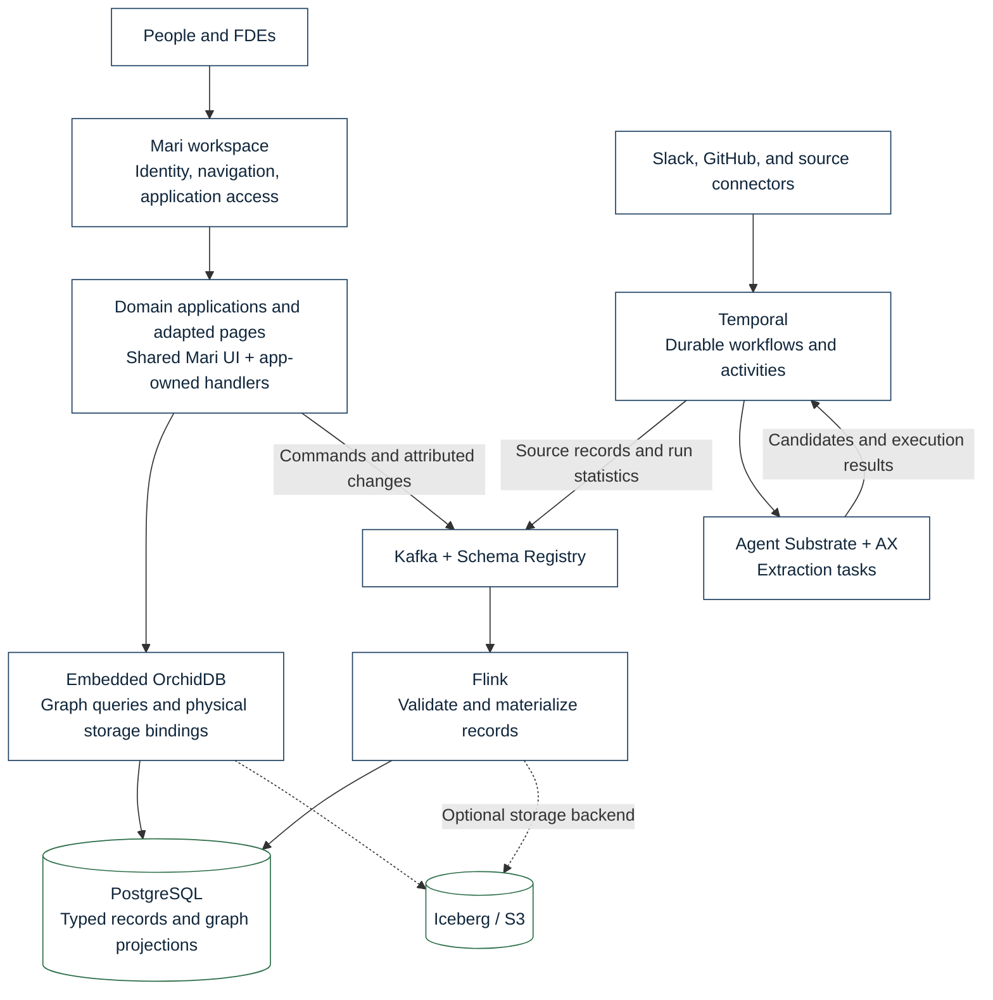
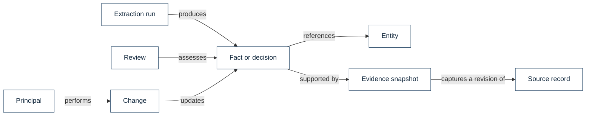
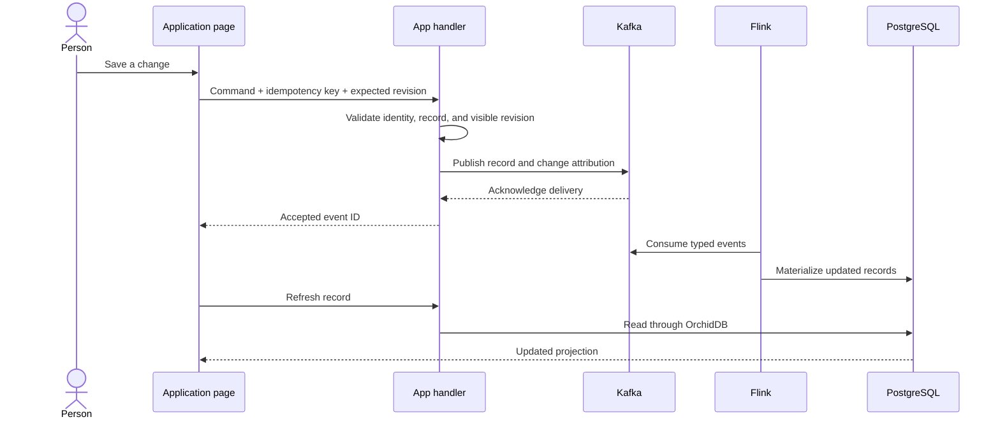
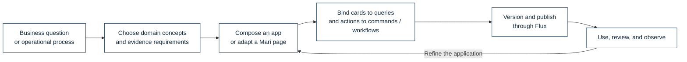
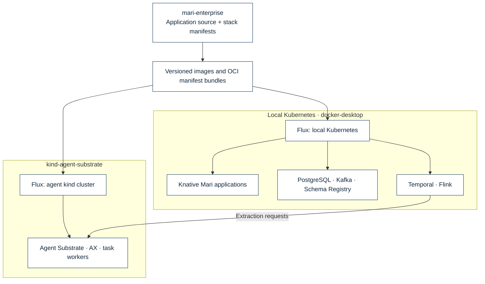

# Mari Enterprise

App source now lives in individual AX workspaces, with private `MariHQ/mari-app-*`
Git repositories as secondary archives. The `apps/*` directories here are Git
submodules. See [App workspaces and Git archives](infra/workspace/README.md) for
coding, serving, direct pushes, native forks, and credential setup.

Mari Enterprise is a platform for turning an organization's information into
knowledge and building applications around it. It connects source systems,
extracts facts and decisions, preserves the evidence behind them, and gives
people a shared workspace for understanding and acting on that knowledge.

Forward deployed engineers (FDEs) shape Mari to fit the organization. They can
build an application, adapt an existing page, define a higher-level ontology, or
connect a workflow to an operational process. The knowledge graph, application
shell, reusable UI, and execution infrastructure provide the common foundation.

## One knowledge foundation, many applications

Mari brings together three layers:

- **Knowledge:** source records, entities, facts, decisions, evidence, and lineage
  form a base ontology. Domain ontologies build on this foundation.
- **Applications:** the workspace provides Knowledge, Facts, Decisions, Lineage,
  Sources, Workflows, Scheduled tasks, Insights, Destinations, and Settings.
  FDEs compose and adapt these surfaces around the work people need to do.
- **Execution:** durable workflows coordinate connectors and agents; an event
  stream carries changes and run statistics; queryable projections power apps.

The source of a claim matters as much as its text. Mari keeps extracted claims
separate from their evidence and review status, so an agent's output can be
inspected before someone treats it as accepted knowledge.

## Architecture

Each application owns its HTTP handlers and reads through an embedded OrchidDB
runtime. There is no separate central Mari query service. OrchidDB maps the
logical graph to physical tables, keeping application queries independent of
the selected storage backend.

PostgreSQL is the default record store. Iceberg and S3 remain an optional path
for lake storage. Flink checkpoint, savepoint, and recovery state use local
persistent storage in the local deployment; their storage location is
configurable independently of the application record store.

## From source information to knowledge

```mermaid
flowchart LR
    Poll["Discover and sync<br/>Slack / GitHub"] --> Record["Normalize source records"]
    Record --> Stream["Publish typed events"]
    Stream --> Store["Materialize queryable records"]
    Store --> Context["Assemble source context"]
    Context --> Extract["Extract entities,<br/>facts, and decisions<br/>Agent Substrate + AX"]
    Extract --> Validate["Validate structure,<br/>quotes, and source revisions"]
    Validate --> Candidate["Publish candidates<br/>with evidence and lineage"]
    Candidate --> Review["Human review"]
    Review --> Use["Use in applications<br/>and domain ontologies"]
    classDef core fill:#FFFFFF,stroke:#1C3F60,color:#10263B;
    classDef review fill:#FFFFFF,stroke:#B23A1E,color:#10263B;
    class Poll,Record,Stream,Store,Context,Extract,Validate,Candidate,Use core;
    class Review review;
```

Temporal coordinates source synchronization and extraction. Connectors emit
normalized records to Kafka; Flink materializes those records for reads. Mining
workflows assemble bounded context and invoke extraction through AX on Agent
Substrate. Mari-kit supplies reusable parsing and knowledge primitives.

Extraction produces candidates with source references, quoted evidence, and run
attribution. Validation checks the output shape, source revisions, and whether
quoted evidence occurs in the source. These checks establish traceability;
review establishes whether a claim deserves acceptance.

Runs have explicit context and spending budgets. Execution statistics travel
through Kafka alongside the other typed records, giving the UI a persistent
view of activity, candidates, token usage, and cost where reported. Durable
execution and cached completed calls reduce unnecessary repeated model work.

## The base ontology

The base ontology stays small enough to reuse across teams and domains.

| Concept | What it represents |
| --- | --- |
| Source record | A message, file, issue, or other item obtained from a connected system |
| Entity | A named person, team, system, project, or other subject referenced by knowledge |
| Fact | A claim about the world, with a lifecycle and review status |
| Decision | A choice recorded in context, with supporting evidence |
| Evidence | A quoted source snapshot tied to a specific source revision |
| Extraction run | The execution that produced candidates and its operational statistics |
| Review | A person's assessment of a claim |
| Change and principal | An attributed operation and the identity responsible for it |

These are conceptual relationships; physical record types and graph bindings
live in the ingestion schema and shared catalog. A domain ontology can add
concepts such as customers, services, incidents, obligations, or product releases
without discarding the underlying evidence trail.

Lineage lets a person move from a claim to its evidence, source, and producing
run. Keeping revisions in that chain makes it possible to identify claims whose
supporting source has changed.

## Reading, editing, and observing

The workspace owns sign-in and navigation. It routes authenticated requests to
individual applications using short-lived app grants. Application handlers own
their queries and commands; shared presenters receive data and explicit actions.
Cards can resolve their own data, so a slow query does not need to block an
entire page.

Writes take an asynchronous path:

Accepted means Kafka acknowledged the command. The database projection follows
asynchronously. The UI tracks the accepted event while reads catch up. Review
states distinguish new or edited claims from verified knowledge.

## FDE application building

Dynamic app building makes Mari a workspace an FDE can reshape for a specific
organization. An application can start from a shared page, compose existing
components, or introduce a new surface backed by the same knowledge and workflow
services. Existing pages are adaptable rather than fixed product boundaries.

The shared contract is straightforward: presenters render data, adapters resolve
it, handlers enforce the application boundary, and workflows perform durable
work. An incident workspace can combine services, decisions, and source messages;
a customer workspace can combine account knowledge, obligations, and follow-up
work. Both reuse the base ontology and its provenance.

Applications carry their own queries and actions while reusing Mari's identity,
navigation, design components, event contracts, and operational visibility.
Versioned application definitions and deployment manifests keep changes
reviewable and reproducible.

## Deployment boundaries

Shared services and Mari applications run on the local Kubernetes cluster.
Agent Substrate and AX run in a dedicated kind cluster. Flux reconciles the
workloads in both environments.

The checked-in stack owns shared infrastructure; Mari's Flux stages own its
schema, applications, ingestion, and worker. Releases publish immutable image
references and manifest bundles for Flux to reconcile. The local app manifests
keep a minimum instance available to avoid scale-to-zero activation delays.

Credentials, Terraform state, local tool binaries, logs, and runtime data stay
outside Git. This repository contains the application and infrastructure source;
Kubernetes, external tools, provider access, and release artifacts such as the
OrchidDB wheel are supplied by the environment.

## Repository map

| Path | Responsibility |
| --- | --- |
| [`container/`](container/) | Workspace shell, authentication, navigation, and app routing |
| [`apps/`](apps/) | App handlers, query projections, adapters, and pages |
| [`apps/base/`](apps/base/) | Shared runtime, OrchidDB catalog, schemas, commands, and frontend utilities |
| [`temporal/`](temporal/) | Connectors, schedules, extraction, observations, and maintenance workflows |
| [`flink/`](flink/) | Typed ingestion declaration, schema application, and storage sinks |
| [`flux/`](flux/) | Ordered Mari deployment stages and topic manifests |
| [`infra/`](infra/) | Runtime configuration, release publishing, and agent image recipes |
| [`stack/`](stack/) | Shared Kubernetes infrastructure, agent cluster manifests, and operational scripts |
| [`vendor/`](vendor/) | Included Mari UI, component packages, and runtime source snapshots |

## License

Existing source retains its [Apache License 2.0](LICENSE.md) license and
[notices](NOTICE). Vendored dependencies retain their own license and attribution
files.

## Independent app development

[Workspace authoring](infra/workspace/README.md) describes native AX agents,
workspace-owned code, Git mirrors, forks, and dynamic app discovery.
The separate private [Mari command dashboard](https://github.com/MariHQ/mari-dash)
provides the operator UI; its README includes live screenshots and a downloadable
[Job Reports PDF](https://github.com/MariHQ/mari-dash/blob/main/docs/evidence/recent-jobs.pdf)
produced from real Temporal executions by an AX-authored app.
